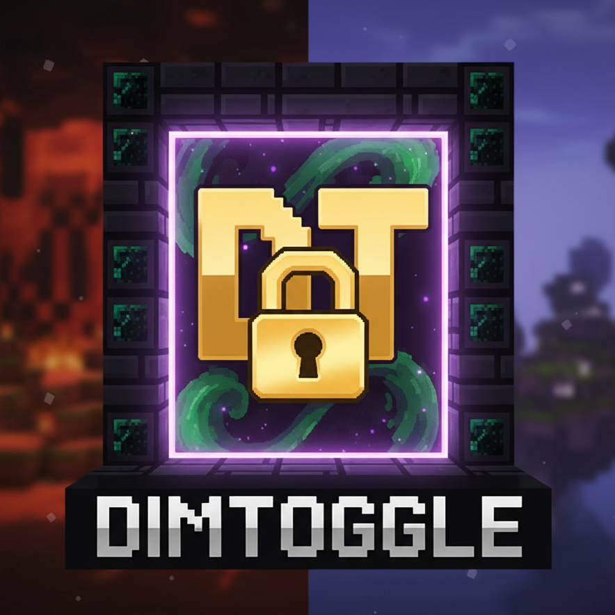

<div align="center">



# DimToggle

**Lightweight, server-side dimension access control, timed locking, and safe portal routing for Minecraft.**

[](https://github.com/KyroXova/DimToggle/releases/latest)
[](https://www.curseforge.com/minecraft/mc-mods/dimtoggle)
[](https://github.com/KyroXova/DimToggle/actions/workflows/build.yml)
[](RELEASES.md)
<br>
[](RELEASES.md#supported-versions--downloads)
[](RELEASES.md#supported-versions--downloads)
[](RELEASES.md#supported-versions--downloads)
[](#features)
[](LICENSE)
[](RELEASES.md)

| [📖<br><nobr>Overview</nobr>](#dimtoggle) | [✨<br><nobr>Features</nobr>](#features) | [⚡<br><nobr>Commands</nobr>](#commands--permissions) | [⚙️<br><nobr>Config</nobr>](#configuration-configdimtogglejson) | [📦<br><nobr>Releases</nobr>](RELEASES.md) | [📜<br><nobr>Changelog</nobr>](changelogs/changelog_1.0.0_to_2.0.1.md) |
| :---: | :---: | :---: | :---: | :---: | :---: |

</div>

---

**DimToggle** is a lightweight, server-side dimension access control and locking mod for Minecraft. It allows server administrators and modpack creators to lock, unlock, restrict, and manage access to any vanilla or modded dimension dynamically or on a timer.

---

## Features

- **Dynamic Dimension Locking**: Lock any dimension permanently or for a specific duration (e.g. `2d`, `12h30m`, `45m`).
- **Timed Expiry and Announcements**: Automatically unlocks dimensions when the timer expires and broadcasts server-wide chat notifications.
- **Granular Access Control**:
  - **Operator Bypass**: Configurable (`allowOps`) permission level 2 access.
  - **Player Allowlist**: Grant specific players entry to locked dimensions via commands (`/dimtoggle allow`) or config.
  - **Group Allowlist**: Allowlist player groups via commands (`/dimtoggle allowgroup`), Scoreboard Teams, or LuckPerms groups.
  - **LuckPerms Integration**: Full support for permission nodes (`dimtoggle.bypass`, `dimtoggle.<namespace>.<dimension>`).
- **Safe Enforcement**:
  - Prevents portal traps, void falling, and travel loops by safely relocating unauthorized players to world spawn (`teleportToSpawn`).
  - Configurable rate-limited warning messages to avoid chat spam.
- **Admin Teleport Utility**: Safely teleport players across dimensions using `/dt <player> <dimension>`.
- **Server-Side Only**: Runs entirely on the server (dedicated server or internal server in singleplayer/LAN). Connecting players do not need the mod installed.

---

## Commands & Permissions

All administrative commands require permission level 2 (Operators) or the `dimtoggle.admin` permission node.

| Command | Description |
| :--- | :--- |
| `/dimtoggle list` | Display all currently locked dimensions, active timers, and remaining time. |
| `/dimtoggle lock <dimension> [duration]` | Lock a dimension permanently or for a duration (e.g. `1d`, `12h30m`, `45m`). |
| `/dimtoggle unlock <dimension>` | Unlock a dimension for all players. |
| `/dimtoggle enable <dimension>` | Lock alias (adds dimension to restricted list). |
| `/dimtoggle disable <dimension>` | Unlock alias (removes dimension from restricted list). |
| `/dimtoggle allow <dimension> <player>` | Grant an individual player access to a locked dimension. |
| `/dimtoggle disallow <dimension> <player>` | Remove a player from a locked dimension's allowlist. |
| `/dimtoggle allowgroup <dimension> <group>` | Grant a group (LuckPerms or Scoreboard Team) access to a dimension. |
| `/dimtoggle disallowgroup <dimension> <group>` | Remove a group from a dimension's allowlist. |
| `/dimtoggle reload` | Reload the `config/dimtoggle.json` configuration file. |
| `/dt <player> <dimension>` | Safely teleport a player to the target dimension's spawn point. |

### Permission Nodes (LuckPerms)

- `dimtoggle.admin`: Full access to all DimToggle commands.
- `dimtoggle.bypass`: Allows entering any locked dimension regardless of restrictions.
- `dimtoggle.<namespace>.<dimension>`: Grants access to a specific dimension (e.g. `dimtoggle.minecraft.the_end`).

---

## Configuration (`config/dimtoggle.json`)

```json
{
  "enableLuckPerms": true,
  "teleportToSpawn": true,
  "allowOps": true,
  "restrictedDimensions": [
    "minecraft:the_end",
    "minecraft:the_nether"
  ],
  "allowedUsers": {
    "minecraft:the_end": [
      "Alice",
      "Bob"
    ]
  },
  "allowedGroups": {
    "minecraft:the_end": [
      "vip",
      "donator"
    ]
  },
  "notificationCooldownSeconds": 3
}
```

- **`enableLuckPerms`**: Enables LuckPerms permission checking if LuckPerms is installed.
- **`teleportToSpawn`**: When `true`, players attempting to enter an unauthorized dimension are safely relocated to world spawn.
- **`allowOps`**: When `true`, server operators (level 2+) bypass dimension locks.
- **`restrictedDimensions`**: Initial list of locked dimensions for newly created worlds.
- **`allowedUsers`**: Map of dimension identifiers to lists of explicitly allowed player names.
- **`allowedGroups`**: Map of dimension identifiers to lists of explicitly allowed group/team names.
- **`notificationCooldownSeconds`**: Cooldown interval between warning notifications when unauthorized players attempt entry.

---

## Releases

> [!TIP]
> 📦 **Dedicated Releases Catalog**: All 98 server-side JAR downloads across 40 Minecraft versions (1.16 through 26.3) for Fabric, Forge, and NeoForge are hosted on [**RELEASES.md**](RELEASES.md) and [**GitHub Releases**](https://github.com/KyroXova/DimToggle/releases/latest).

| Release | Status | Minecraft Compatibility | Target Builds | Changelog | Direct Downloads |
|:---:|:---:|:---:|:---:|:---:|:---:|
| [**v2.0.1**](https://github.com/KyroXova/DimToggle/releases/tag/v2.0.1) | Production (Latest) | 1.16 - 26.3 (40 versions) | 98 Targets | [changelog_1.0.0_to_2.0.1.md](changelogs/changelog_1.0.0_to_2.0.1.md) | [98 Asset JARs](https://github.com/KyroXova/DimToggle/releases/tag/v2.0.1) · [RELEASES.md](RELEASES.md) |
| [**v2.0.0**](https://github.com/KyroXova/DimToggle/releases/tag/v2.0.0) | Superseded | 1.16 - 26.3 (40 versions) | 98 Targets | [changelog_1.0.0_to_2.0.0.md](changelogs/changelog_1.0.0_to_2.0.0.md) | [98 Asset JARs](https://github.com/KyroXova/DimToggle/releases/tag/v2.0.0) |

---

## Authors

DimToggle is developed and maintained by **Kingodogo** and **KyroXova**.

---

## License

DimToggle is released under the MIT License.
